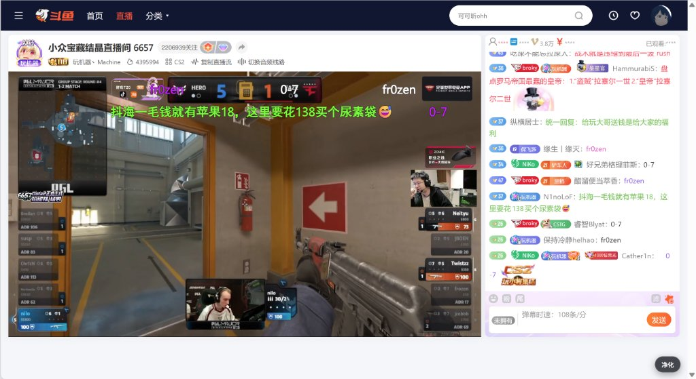
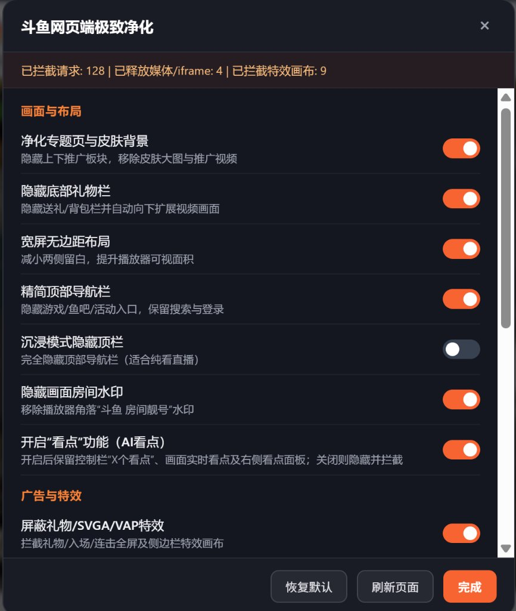

# 斗鱼网页端极致净化 (Douyu Purify)

一款面向斗鱼网页端直播间的高性能油猴净化脚本：**保留直播画面、播放器控件、画面内弹幕与右侧弹幕互动**，彻底移除广告、礼物栏、SVGA/VAP/Spine 特效动画、专题页推广板块及后台冗余 iframe，显著降低浏览器 CPU / GPU 与内存占用。

## 一键安装

1. 确保浏览器已安装 [Tampermonkey（篡改猴）](https://www.tampermonkey.net/) 或 [Violentmonkey（暴力猴）](https://violentmonkey.github.io/)。
2. 点击下方链接即可直接安装并自动接收后续更新：
   - **[安装 douyu-purify.user.js](https://raw.githubusercontent.com/jvjjjj/douyu-purify/main/douyu-purify.user.js)**
3. 或手动新建脚本，将仓库中的 `douyu-purify.user.js` 全文复制粘贴保存。

## 效果预览

### 净化后直播间界面
保留直播画面、播放器控件、画面弹幕与右侧弹幕互动，移除底部礼物栏、专题页板块、广告挂件与贵宾榜单：

### 设置面板与实时拦截统计
支持分项实时开关与拦截统计查看（请求拦截 / 媒体与 iframe 释放 / 特效画布拦截）：

## 核心特性

- **核心观看体验完整保留**：
  - 保留直播视频流、播放器控制栏（清晰度、音量、刷新、弹幕开关与屏蔽设置、全屏等）、画面内弹幕层、右侧弹幕列表（含锁屏/清屏按钮）及发言输入框。
  - 兼容主流第三方斗鱼扩展注入的控件（如刷新线路、烂梗面板、真实人数显示等）。
- **深度界面净化**：
  - **专题页净化**：隐藏专题页上下推广板块与皮肤大图，暂停并释放推广 `<video>` 解码占用。
  - **隐藏礼物栏**：隐藏底部礼物/背包栏，并利用原生布局变量向下扩展视频画面。
  - **广告与挂件清理**：屏蔽视频内贴片广告、PK 条、竞猜、弹窗、侧边栏悬浮广告、右侧边缘浮窗及顶部活动挂件。
  - **弹幕区与顶栏精简**：隐藏贵宾/贡献榜以扩大弹幕区高度，过滤进房/送礼/系统推广消息，精简顶栏与发言栏冗余付费按钮。
- **独立「看点」功能开关**：
  - 与广告屏蔽完全解耦，可在设置面板中随时开启/关闭控制栏「X个看点」入口、画面实时看点条及右侧看点抽屉面板。
- **底层性能优化（CPU / GPU / RAM）**：
  - **精准网络拦截**：拦截 `dotcounter`/`apm` 埋点、`rtbapi` 广告、`.svga`/`.vap` 特效包、全站礼物广播轮询、推广 `.mp4` 与后台冗余 iframe；**白名单优先放行** `.flv`/`.m3u8`/`.ts`/`.m4s` 直播流及 `getH5Play`/`betard`/`danmuproxy` 核心接口。
  - **特效画布零开销拦截**：对礼物/SVGA/VAP/Spine 容器内的 `<canvas>` 返回轻量级空操作 `Proxy` 上下文并归零画布尺寸，避免动画渲染占用 GPU。
  - **React 安全清理**：不直接移除 React 托管节点，通过 `document-start` CSS 注入、媒体/iframe 置空及纯 CSS 弹幕渲染上限（默认 120 条）防止长时间观看卡顿与页面崩溃。
- **独立设置面板（Shadow DOM）**：
  - 右下角悬浮「净化」按钮（全屏自动隐藏），或通过扩展菜单 **⚙️ 打开斗鱼净化设置** 打开面板，支持分项实时切换与拦截统计查看。

## 设置面板选项说明

| 分组 | 配置项 (`key`) | 默认值 | 说明 |
| --- | --- | --- | --- |
| 画面与布局 | `purifyTopic` | 开启 | 净化专题页上下推广板块、皮肤大图与推广视频 |
| 画面与布局 | `hideGiftBar` | 开启 | 隐藏底部礼物栏并向下扩展视频画面 |
| 画面与布局 | `wideLayout` | 开启 | 宽屏无边距布局，减小两侧留白 |
| 画面与布局 | `cleanHeader` | 开启 | 精简顶部导航栏（保留搜索、关注、历史、登录） |
| 画面与布局 | `hideHeader` | 关闭 | 沉浸模式：完全隐藏顶部导航栏 |
| 画面与布局 | `hideWatermark` | 开启 | 隐藏播放器画面角落「斗鱼 房间靓号」水印 |
| 画面与布局 | `enableHighlight` | 关闭 | 开启「看点」功能（控制栏看点入口、实时看点与看点面板） |
| 广告与特效 | `blockEffects` | 开启 | 屏蔽礼物/入场/连击/SVGA/VAP/Spine 特效与画布 |
| 广告与特效 | `blockAdsPendants` | 开启 | 屏蔽贴片广告、挂件、悬浮球、PK、竞猜与弹窗 |
| 广告与特效 | `hideRank` | 开启 | 隐藏右侧贵宾/贡献榜，扩大弹幕显示高度 |
| 广告与特效 | `cleanBarrage` | 开启 | 过滤进房提醒、送礼通知、系统推广与顶部飘条 |
| 广告与特效 | `cleanChatTools` | 开启 | 精简发言栏上方冗余付费按钮 |
| 性能与底层拦截 | `blockIframes` | 开启 | 拦截任务中心、微信小游戏、私信等后台 iframe |
| 性能与底层拦截 | `blockNetwork` | 开启 | 拦截埋点/广告/特效资源请求（改动后需刷新生效） |
| 性能与底层拦截 | `capBarrageDom` | 开启 | 仅保留最新 120 条弹幕可见，防止长时间观看卡顿 |
| 性能与底层拦截 | `showFloatBtn` | 开启 | 显示右下角「净化」悬浮设置按钮 |

## 兼容说明

- 适配斗鱼新版 Next.js 直播间（`live-next-body`）、专题包装直播间（`/topic/*` 及带专题容器的房间）及经典版直播间。
- 脚本仅在直播间/专题页生效，不影响斗鱼首页、分类目录等页面正常浏览。

## 更新日志

- **v1.1.1**
  - 修复开启「看点」功能后点击控制栏「X个看点」无法弹出右侧看点面板的问题（适配 `WebViewWithUnique` 实际渲染结构 `iframe[src*="ai-live-summary"]`）。
  - 排除 `/pages/*` 子页面及 iframe 嵌套环境执行，避免脚本误注入看点面板内部。
- **v1.1.0**
  - 新增「看点」功能独立开关（`enableHighlight`），与广告屏蔽解耦，可按需开启/关闭。
  - 添加 GitHub `@downloadURL` / `@updateURL` 自动更新源与 `MIT` 协议声明。
- **v1.0.0**
  - 初始版本：实现 `document-start` CSS 净化、精准网络拦截、特效画布 GPU 零开销拦截、React 安全 DOM 清理与 Shadow DOM 设置面板。

## License

[MIT](./LICENSE)
